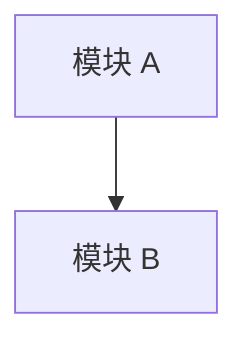
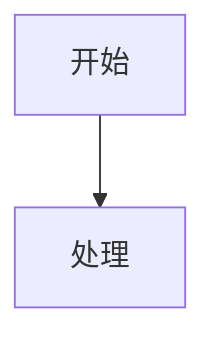

# Context 模板

用于生成产品线独立 context 仓库中的 `AGENTS.md`、raw 材料包、workspace 工作包和稳定产品 context 文档。

## 根 AGENTS.md 模板

```markdown
# 产品 Context 仓库

本仓库沉淀【产品名】的上下文。仓库内只维护本产品线材料，不维护跨产品共享业务层，也不承载对外发布工作流。

## 读取优先级

1. `context/`：已确认、稳定、可复用的产品知识，研发默认优先读取。
2. `workspace/`：当前正在推进的版本、需求、项目和讨论。
3. `drafts/`：待确认整理、分析草稿和中间判断。
4. `raw/`：原始材料和证据，只用于来源追溯。

## 写入规则

- 原文、附件、截图、聊天记录、历史 PRD 放入 `raw/`。
- 摘要、分析、备选方案和待确认判断放入 `drafts/`。
- 当前版本、项目、需求、bug、评审记录放入 `workspace/`。
- 已上线、已确认、当前生效的产品事实放入 `context/`。
- 每次写入后同步目标目录的 `AGENTS.md`。
```

## 子目录 AGENTS.md 模板

```markdown
# 目录说明

## 职责

本目录用于存放【目录职责】。

## 不放什么

- 【不应放入的内容 1】
- 【不应放入的内容 2】

## 读取规则

- 【什么时候读取本目录】
- 【优先读取哪些文件】

## 文件索引

| 文件/目录 | 用途 | 维护说明 |
|---|---|---|
| `example.md` | 示例用途 | 新增或变更时同步本索引 |
```

## raw 材料包模板

```text
raw/source-files/YYYY-MM-DD-topic/
|- AGENTS.md
|- source/
`- notes.md
```

`notes.md`：

```markdown
# 原始材料包：主题

## 来源

- 来源渠道：
- 获取时间：
- 提供人：
- 相关版本/项目：

## 文件清单

| 文件 | 类型 | 说明 |
|---|---|---|
| [文件名](source/文件名) | PRD/PPT/Excel/PDF/截图 | 原始说明 |

## 处理状态

- 当前状态：未提炼 / 已提炼到 drafts / 已沉淀到 context
- 关联文档：

## 备注

只记录来源和文件说明，不在本文件中替代正式提炼。
```

## workspace 版本工作包模板

```text
workspace/<version>/
|- AGENTS.md
|- prd/
|- requirement-breakdown/
|- discussions/
|- bugs/
|- demo/
`- release/
```

版本 `AGENTS.md`：

```markdown
# 版本工作包：版本号

## 版本目标

## 当前状态

## 目录说明

| 目录 | 用途 |
|---|---|
| `prd/` | 当前版本 PRD |
| `requirement-breakdown/` | 需求拆解 |
| `discussions/` | 评审、会议、讨论记录 |
| `bugs/` | 当前版本 bug 和问题 |
| `demo/` | demo 或原型 |
| `release/` | 发布材料 |

## 待沉淀事项

- 上线后需要回写到 `context/` 的能力：
- 需要进入版本记录的内容：
```

## 产品结构文档模板

```markdown
# 产品结构 / 主题

## 概述

## 产品定位

## 核心角色

## 核心实体

## 模块结构



## 关键术语

| 术语 | 定义 | 备注 |
|---|---|---|

## 来源追溯

- [来源文件](../../raw/...)
```

## 功能特性文档模板

```markdown
# 模块 / 功能特性

## 特性概述

## 触发入口与交互

| 项 | 说明 |
|---|---|
| 入口位置 |  |
| 触发动作 |  |
| 前置条件 |  |
| 交互结果 |  |

## 当前生效规则

### 业务规则

### 校验规则

### 计算规则

### 权限/分群规则

## 异常处理

| 异常场景 | 系统处理 | 用户可执行动作 | 提示/日志 |
|---|---|---|---|

## 上游依赖

## 下游流转

## 数据与字段

| 字段 | 含义 | 来源 | 是否必填 | 备注 |
|---|---|---|---|---|

## 流程图



## 来源追溯

- [来源文件](../../raw/...)
```

## 版本时间线模板

```markdown
# 版本时间线

| 版本 | 需求设计开始时间 | 产品评审完成时间 | 上线时间 | 版本核心目标 | 版本核心内容 | 影响模块 | 关联功能文档 | 来源 |
|---|---|---|---|---|---|---|---|---|
```

缺失时间写“未在来源材料中确认”，不要推测。
